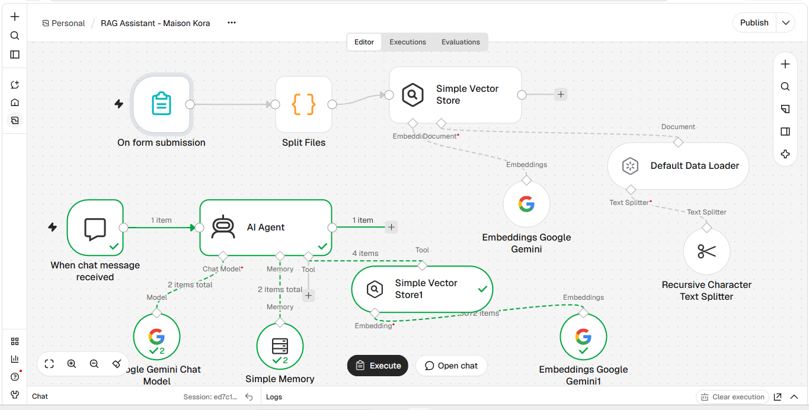
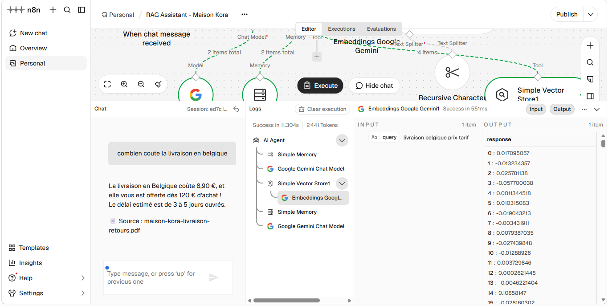

# AI Document Assistant (RAG)

**A customer-service chatbot that answers only from your company's documents — and says so when it doesn't know.**

Built with **n8n** and **Google Gemini**, using Retrieval-Augmented Generation (RAG).



---

## The problem

Customer-service teams answer the same questions all day: delivery times, return policy, warranty, opening hours.
The answers already exist in PDFs and help pages, but customers don't read them, and generic chatbots **make things up**.

## The solution

1. The company uploads its documents (PDF) through a simple form.
2. Each document is split into small chunks and turned into embeddings (vectors that capture meaning).
3. A customer asks a question in a chat window.
4. The assistant finds the 4 most relevant chunks and answers **only from them**, in the customer's language.
5. Every answer ends with its **source document**. If the answer isn't in the documents, the assistant says so and gives the support contact.

> **No invented prices, delays or conditions. Every answer can be checked.**



## Test results

Demo company: *Maison Kora*, a fictitious leather-goods brand (3 PDFs: delivery & returns, warranty & care, store FAQ).

| Question | Expected | Result |
|---|---|---|
| How much is delivery to Belgium? | €8.90, free from €120, 3–5 days | ✅ |
| Can I return a bag engraved with my initials? | No, unless defective | ✅ |
| My zip broke after 3 years, what can I do? | Out of warranty: €35 repair, 10 days | ✅ |
| Do you ship to Canada? *(asked in English)* | No — answered in English | ✅ |
| What is the price of the black Lin bag? | Not in the documents → says so + support contact | ✅ |
| "And for Switzerland?" *(follow-up)* | €14.90, 4–6 days, customs paid by customer | ✅ (uses conversation memory) |

## How it works

```
Indexing:  Form (PDF upload) → Split Files → Vector Store (insert)
                                              ├─ Default Data Loader (+ source metadata)
                                              ├─ Recursive Text Splitter (800 / 100)
                                              └─ Gemini Embeddings

Chat:      Chat Trigger → AI Agent ──┬─ Gemini Chat Model
                                     ├─ Simple Memory (10 messages)
                                     └─ Tool: Vector Store (top 4 chunks + metadata)
```

| Component | Role |
|---|---|
| **Split Files** (Code) | Splits a multi-file upload into one item per file, keeping the file name |
| **Default Data Loader** | Reads the PDF and attaches `source = file name` to every chunk |
| **Recursive Character Text Splitter** | Chunks of 800 characters with 100 overlap (≈ 1–2 paragraphs) |
| **Gemini Embeddings** | Same model for indexing and search (required) |
| **AI Agent** | System prompt: search first, answer only from results, cite the source, admit when unknown |
| **Simple Memory** | Allows follow-up questions |

## Run it yourself

1. Install n8n (`npm install -g n8n` then `n8n start`) — Node.js 20+.
2. Import `workflow.json`.
3. Create a **Google Gemini (PaLM) API** credential with your Gemini API key.
4. Execute the workflow, open the form and upload the 3 PDFs from `docs/`.
5. Click **Open chat** and ask a question.

The demo uses n8n's in-memory vector store (cleared when n8n restarts).
For production, swap it for **Supabase (pgvector), Qdrant or Pinecone** — only that node changes.

All documents in `docs/` are **fictitious** and created for this demo.

## Use cases

- Customer support for e-commerce (delivery, returns, warranty)
- Internal HR assistant (leave policy, onboarding, procedures)
- Training organisations (programmes, prices, certification rules)
- Agencies: a white-label assistant for each client website

---

Built by **Daniel Mama** — LionTech · AI automation for SMEs and agencies
[GitHub](https://github.com/Mamzilion)
